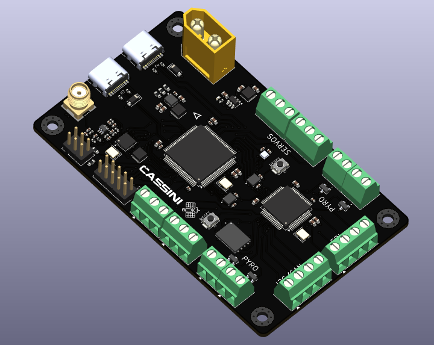

# 

### A **rocket flight computer** designed for a self landing rocket.

## Overview

I had a  of fun designing this project, though there may still be a few mistakes here and there, so forgive me for that



Feel free to suggest improvements, modify the design, or contribute your own ideas to the project as well!


See [Schematics](KiCAD/CASSINI.pdf)

## Extra Info

1. **Use a 2s-3s LiPo battery** if you decide to use this board in your project. **Discard the battery if it smells "funny".**

2. **Check for any damage on the pcb** as it can be the reason for a **catastrophic failure**.

3. **USE A 915MHz SMA ANTENNA ONLY!** Others will work fine but you'll spend a while wondering about the poor range.

## Firmware Flashing Instructions

### 1. Clone the repository

```bash
git clone git@github.com:GoTouchGra55/GRAVITAS.git
```

### 2. Open the project in a code editor

Navigate into the firmware directory. For VS Code users:

```bash
cd GRAVITAS
code .
```

### 3. Edit the code

You have all the freedom to implement your own new features. Infact, I encourage you to do so.

Just be sure to add your drivers to the `CMakeLists.txt` file or you'll be stuck with a nasty build error and wonder why your code won't work.

_(Speaking from experience)_

### 4. Build the firmware

```bash
cmake --preset Debug
cmake --build --preset Debug
```

### 5. Connect the ST-Link debugger

Connect the pins according to the silkscreen and the debugger labels.

Note: You can skip the 3.3V if your board is powered by an external power source.

### 6. Flash the firmware

With the ST-Link connected, press the Debug button in VS Code.

Cortex-Debug will launch the debugger and program the generated .elf file into the STM32's internal flash.

Once the firmware has been flashed, you can stop the debugging session.

### 7. Disconnect the ST-Link

You can now disconnect the ST-Link from the GRAVITAS board before testing standalone operation.

The ST-Link is connected to the STM32's debug and reset circuitry. Leaving it connected can affect the NRST line and prevent the board from operating correctly when powered independently.

I faced this error during the final phases of development and thought that it was a hardware error from my part, but really, it's the debugger. So, always remove before testing standalone operation.

### 8. Power the board

Disconnect USB and power GRAVITAS from a suitable power source.

The STM32 should now boot directly from its internal flash and execute the newly flashed firmware.

## Bill Of Materials

| # | Component / Item | Specifications | Qty. | Price (USD) |
|---:|---|---|---:|---:|
| 1 | KF350 Terminal Blocks | 3-pin, 3.5 mm pitch, 10 pcs | 1  | $4.03 |
| 2 | KF350 Terminal Blocks | 2-pin, 3.5 mm pitch, 10 pcs | 1  | $3.67 |
| 3 | SMD Resistor Assortment | 660 pcs, mixed packages and values | 1  | $3.85 |
| 4 | SMD Resistor Assortment | 1,500 pcs, 0603, 60 values | 1  | $6.40 |
| 5 | SMD Ceramic Capacitor Assortment | 2,500 pcs, 50 values, mixed packages | 1  | ~$9.15 |
| 6 | SMD Ceramic Capacitor Assortment | Mixed packages and quantities | 1  | $6.54 |
| 7 | STM32F405RGT6 Microcontroller | LQFP-64 | 1 pc | $6.09 |
| 8 | CD54 SMD Power Inductor Assortment | 20 pcs, assorted inductance values | 1  | $4.43 |
| 9 | JLCPCB PCB Fabrication & Assembly | PCB manufacturing and assembly order | 1 order | $245.02 |
| | **Daraz Merchandise Subtotal** | | | **$44.16** |
| | Daraz Discount | | | −$1.77 |
| | Daraz Shipping | | | $2.38 |
| | **Daraz Total** | | | **$46.54** |
| | **JLCPCB Total** | | | **$245.02** |
| | **GRAND TOTAL** | | | **$291.56** |

### See [Gerber File](KiCAD/production/CASSINI.zip)

## License

### MIT License - see [LICENSE](LICENSE)

## Author

### **Shaurya Tamang**

Contact: [Email](shauryatamang.dev@gmail.com)
